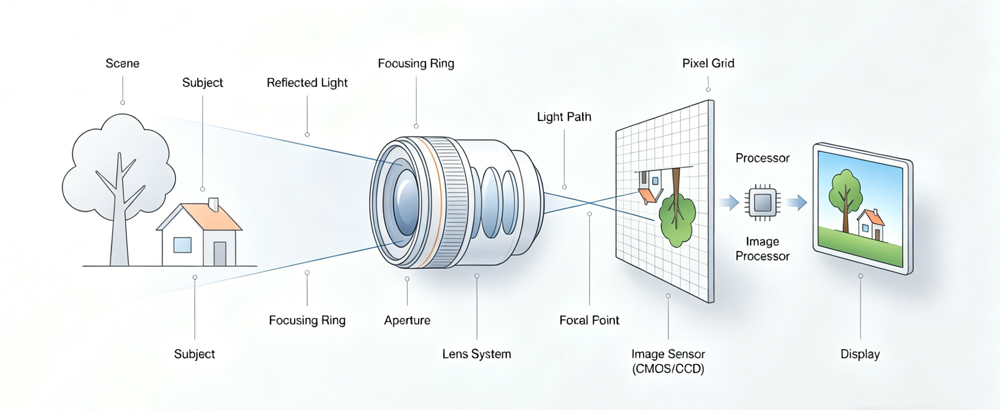

# 摄影教学与仿真平台

**Photo Exposure Simulator** · 把「光圈 / 快门 / ISO」变成看得见的画面变化


一个面向摄影初学者的交互式教学 Web 应用。它把"背参数"变成"调参数、看画面"：先读理论，再做随堂测验，然后在仿真沙盒里自由拧动三要素，最后在闯关模式中完成有约束的拍摄任务。

- **纯前端渲染引擎**：用 Canvas 2D 合成前景 / 背景，逐像素模拟曝光、噪声、色调映射与景深虚化。
- **真实曝光逻辑**：基于 EV 差量计算画面亮度，参数之间的此消彼长符合互易律。
- **即时反馈**：每一次拖动滑块，画面、EV 指示表、直方图同步刷新。
- **无前端构建流程**：HTML + CSS + 原生 JS，改完刷新即可，适合教学与二次开发。

---

## 目录

- [项目简介](#项目简介)
- [功能模块](#功能模块)
- [界面预览](#界面预览)
- [技术栈](#技术栈)
- [整体架构](#整体架构)
- [快速开始](#快速开始)
- [目录结构](#目录结构)
- [核心实现](#核心实现)
- [后端 API](#后端-api)
- [数据库设计](#数据库设计)
- [常见问题](#常见问题)
- [已知限制](#已知限制)
- [许可证与素材说明](#许可证与素材说明)

---

## 项目简介

摄影入门最反直觉的一点是：光圈、快门、ISO 三个参数彼此耦合，动一个就要拿另一个来补。传统教材只能用静态示意图解释"大光圈虚化""慢门拖影"，初学者很难建立手感。

本项目尝试把这条链路完整地做出来：

1. **理论学习**——文章由后端从 MySQL 读取，涵盖镜头光学、曝光三要素、互易律与直方图。
2. **随堂测验**——每个知识点配套 3 道题，答错立即给出解析。
3. **仿真演练**——拖动滑块，实时看到画面明暗、背景虚化、噪点颗粒和直方图形态的变化，并配有模拟相机的 HUD 界面。
4. **闯关挑战**——在限定条件（如"快门不能慢于 1/500s"）下找到正确曝光组合。

适合作为 Web 全栈课程设计、摄影教学演示，或者一个可以继续扩展的 Canvas 图像处理实验场。

---

## 功能模块

| 模块 | 入口 | 说明 |
| --- | --- | --- |
| 门户导航 | `index.html` | 全屏视觉首页，三个主入口：理论学习 / 仿真演练 / 闯关挑战 |
| 理论学习 | `theory.html` | 左侧知识点树（6 篇），右侧文章区，内容通过 REST API 从数据库加载；文末自动注入"进入测验"按钮 |
| 随堂测验 | `quiz.html?topic=xxx` | 按知识点出题，选项即时判定、高亮正误、展示解析，百分制结算页 |
| 仿真演练 | `simulator.html` | 三要素滑块 + 双 Canvas 合成 + 逐像素曝光引擎 + 实时直方图 + 相机取景 HUD |
| 闯关挑战 | `challenge.html` | 3 个场景关卡，除曝光归零外还有额外参数约束，过关后自动切换场景与图片 |
| 关于本站 | `about.html` | 设计思路与功能框架说明 |
| 404 彩蛋 | `404.html` | "画面太暗，无法对焦"——探照灯跟随鼠标 + 对焦框动画 |

---

## 界面预览

<table>
  <tr>
    <td width="50%"><br><sub><b>门户首页</b>：全屏背景 + 三大入口</sub></td>
    <td width="50%"><br><sub><b>仿真演练</b>：相机 HUD、EV 表、实时直方图</sub></td>
  </tr>
  <tr>
    <td width="50%"><br><sub><b>理论学习</b>：侧边栏知识树 + 数据库文章</sub></td>
    <td width="50%"><br><sub><b>闯关挑战</b>：场景任务 + 参数约束判定</sub></td>
  </tr>
  <tr>
    <td width="50%"><br><sub><b>随堂测验</b>：进度条、选项与解析</sub></td>
    <td width="50%"><br><sub><b>关于本站</b>：设计框架（THE FRAMEWORK）</sub></td>
  </tr>
</table>

---

## 技术栈

| 层次 | 技术 | 用途 |
| --- | --- | --- |
| 前端 | HTML5 / CSS3 / 原生 JavaScript（ES6） | 页面结构、视觉风格、交互逻辑，无框架、无构建步骤 |
| 前端图形 | Canvas 2D API | 前景背景合成、像素级曝光处理、直方图、相机 HUD |
| 后端 | Java 17 + Spring Boot 3.2.5 | 提供文章查询 REST 接口 |
| 持久层 | MyBatis-Plus 3.5.7 | 单表 CRUD，`BaseMapper` 免写 SQL |
| 数据库 | MySQL 8（`photo_edu`） | 存放理论文章（HTML 片段） |
| 构建 | Maven（自带 Wrapper） | 后端依赖管理与打包 |

> 前端不依赖 npm / Vite / Webpack，克隆下来起一个静态服务器就能跑。

---

## 整体架构

```text
┌──────────────────────────── 浏览器 ────────────────────────────┐
│  index.html   theory.html   simulator.html   challenge.html    │
│                     │                              │           │
│                     │ fetch JSON                   │ Canvas 2D │
│                     ▼                              ▼           │
│        http://localhost:8080/api/article/…   双画布合成 +      │
│                                             逐像素曝光引擎     │
└──────────────────────┬─────────────────────────────────────────┘
                       │ HTTP / JSON
┌──────────────────────▼──────────────────┐     ┌──────────────────────┐
│        Spring Boot（端口 8080）          │     │  MySQL 8             │
│  ArticleController  →  ArticleMapper    │────▶│  photo_edu.article   │
│  @CrossOrigin("*")                      │     │  （HTML 正文）        │
└─────────────────────────────────────────┘     └──────────────────────┘
```

前后端分离部署：静态页面可以用任意 HTTP 服务器托管，后端单独跑在 8080；跨域已由 `@CrossOrigin` 放行。

---

## 快速开始

### 环境要求

| 依赖 | 版本 | 备注 |
| --- | --- | --- |
| JDK | 17 | `pom.xml` 中 `java.version=17` |
| Maven | 3.6+（或直接用 `./mvnw`） | 仓库内已带 Maven Wrapper |
| MySQL | 8.x | 默认库名 `photo_edu`，端口 3306 |
| 浏览器 | Chrome / Edge / Safari 新版 | 需要支持 Canvas 2D 与 `ctx.filter` |
| Python | 3.x（可选） | 仅用于起一个静态服务器 |

### 1. 初始化数据库

后端不会自动建表，需要先准备数据库和文章数据：

```sql
CREATE DATABASE IF NOT EXISTS photo_edu
  DEFAULT CHARACTER SET utf8mb4
  COLLATE utf8mb4_general_ci;

USE photo_edu;

CREATE TABLE IF NOT EXISTS article (
  id          INT PRIMARY KEY AUTO_INCREMENT,
  key_name    VARCHAR(64)  NOT NULL UNIQUE COMMENT '前端路由键：optics/aperture/...',
  title       VARCHAR(255) NOT NULL,
  content     MEDIUMTEXT   NOT NULL COMMENT 'HTML 片段，直接注入文章区',
  view_count  INT DEFAULT 0 COMMENT '预留：阅读量'
) ENGINE = InnoDB DEFAULT CHARSET = utf8mb4;
```

文章正文是 **HTML 片段**，图片路径建议写成相对站点根目录的 `img/xxx.jpg`。下面是一条可直接用的示例：

```sql
INSERT INTO article (key_name, title, content, view_count) VALUES
('optics', '镜头光学基础',
 '<section><h2>影像的起点</h2>
  <p>每一张照片的诞生，都始于光线穿过第一片镜片的瞬间。</p>
  
  <h3>焦距与透视</h3>
  <p>焦距越短，视角越广；焦距越长，视角越窄，画面空间会被压缩。</p>
 </section>', 0);
```

前端共需要 6 条记录，`key_name` 与文章对应关系如下：

| key_name | 建议标题 | 配图 |
| --- | --- | --- |
| `optics` | 镜头光学基础 | `img/optics_principle.jpg` |
| `aperture` | 光圈 (Aperture) | `img/aperture_demo.jpg` |
| `shutter` | 快门 (Shutter) | `img/shutter_demo.jpg` |
| `iso` | ISO (感光度) | `img/iso_demo.jpg` |
| `reciprocity` | 曝光互易律 | `img/reciprocity_chart.jpg` |
| `histogram` | 曝光直方图 | `img/histogram_demo1.jpg`、`img/histogram_demo2.jpg` |

如果你已有旧库，可以直接导出再导入：

```bash
mysqldump -u root -p photo_edu article > article.sql
mysql -u root -p photo_edu < article.sql
```

> 缺少某条记录时，理论页会落到错误提示状态；补齐 6 条即可。

### 2. 配置并启动后端

编辑 `backend/src/main/resources/application.properties`，把数据库账号密码换成你本机的：

```properties
server.port=8080

spring.datasource.url=jdbc:mysql://localhost:3306/photo_edu?serverTimezone=GMT%2B8&characterEncoding=utf-8
spring.datasource.username=root
spring.datasource.password=你的密码
```

启动方式三选一：

```bash
cd backend

# 方式一：Maven Wrapper（推荐，无需本地装 Maven）
./mvnw spring-boot:run

# 方式二：本机 Maven
mvn spring-boot:run

# 方式三：IDE 中直接运行 BackendApplication.main()
```

打包成可执行 jar：

```bash
cd backend
./mvnw clean package -DskipTests
java -jar target/backend-0.0.1-SNAPSHOT.jar
```

验证接口是否正常：

```bash
curl http://localhost:8080/api/article/optics
# 返回 {"id":...,"keyName":"optics","title":"镜头光学基础","content":"<section>...</section>","viewCount":0}
```

> 第一次执行 `./mvnw` 需要联网下载 Maven 与依赖；如果提示权限不足，先 `chmod +x mvnw`。

### 3. 启动前端

**必须在项目根目录（与 `index.html` 同级）起一个 HTTP 服务**：

```bash
cd photoExposureSimulator
python3 -m http.server 5500
```

然后访问 <http://localhost:5500/>。

其他等效方式：

```bash
npx serve . -l 5500          # Node 环境
# 或 VS Code 的 Live Server
# 或 IntelliJ IDEA 内置静态服务器（Web 根目录要指向项目根目录）
```

这里有两点容易踩坑：

1. **不要双击 HTML 用 `file://` 打开。** 仿真引擎需要读取 Canvas 像素（`getImageData`），本地文件会被判定为跨域而失败，页面会弹出"提取像素失败"。
2. **站点根目录要正好是项目目录。** `js/simulator.js`、`js/challenge.js` 里图片写成 `../img/xxx.jpg`，只有在根路径下访问时浏览器才会把它归一化成 `/img/xxx.jpg`；如果把整个项目挂在 `http://localhost:5500/photoExposureSimulator/` 这样的子路径下，图片会 404。

### 4. 跑通验证

按顺序点一遍，能全部通过就说明环境没问题：

- [ ] 首页背景与三个按钮正常显示
- [ ] 理论学习能加载文章和插图（需要后端 + 6 条数据）
- [ ] 点击"进入测验"，能答题并看到解析与结算页
- [ ] 仿真页拖动三个滑块，画面亮度、EV 指针、直方图同步变化
- [ ] 闯关第一关点击"按动快门"，能收到判定结果

---

## 目录结构

```text
photoExposureSimulator/
├── index.html                  # 门户首页
├── about.html                  # 关于本站 / 功能框架
├── theory.html                 # 理论学习（侧边栏 + 文章容器）
├── simulator.html              # 曝光三要素仿真
├── challenge.html              # 闯关挑战
├── quiz.html                   # 随堂测验
├── 404.html                    # 交互式 404（探照灯 / 对焦框）
├── css/                        # 按页面拆分的样式，品牌色 #FF6B00
│   ├── home.css
│   ├── about.css
│   ├── theory.css
│   ├── simulator.css
│   ├── quiz.css
│   └── challenge.css
├── js/
│   ├── theory.js               # 拉取文章、切换知识点、注入测验入口
│   ├── simulator.js            # 曝光渲染引擎 + 相机 HUD + 对焦交互
│   ├── challenge.js            # 仿真引擎 + 关卡数据 + 通关判定
│   └── quiz.js                 # 题库数据 + 答题 / 计分逻辑
├── img/                        # 背景、前景、示意图素材
├── docs/screenshots/           # README 预览图
└── backend/
    ├── pom.xml
    ├── mvnw / mvnw.cmd
    ├── .mvn/wrapper/maven-wrapper.properties
    └── src/
        ├── main/java/com/photo/backend/
        │   ├── BackendApplication.java   # 启动类，@MapperScan
        │   ├── Article.java              # 实体，映射 article 表
        │   ├── ArticleMapper.java        # 继承 BaseMapper
        │   └── ArticleController.java    # GET /api/article/{keyName}
        ├── main/resources/application.properties
        └── test/java/com/photo/backend/BackendApplicationTests.java
```

---

## 核心实现

### 1. 曝光计算：EV 差量

仿真以 **f/8、1/125 s、ISO 100** 为基准曝光，其余组合都换算成相对基准的曝光差（单位：EV）：

```text
EV_光圈 = 2 × log2(8 / N)        // N 为当前光圈 F 值
EV_快门 =     log2(t / (1/125))  // t 为快门时间，单位秒
EV_ISO  =     log2(S / 100)      // S 为当前 ISO

ΔEV      = EV_光圈 + EV_快门 + EV_ISO
曝光倍数  = 2 ^ ΔEV
```

三个参数同向叠加：开大光圈、放慢快门、提高 ISO 都会让 `ΔEV` 变大。这就是"互易律"在本项目中的直接体现——缩小两档光圈带来的亮度损失，可以用放慢两档快门完全补回来。

相机 HUD 上的 EV 指示表就是把这个 `ΔEV` 映射到 `-3 ~ +3` 的刻度，超出 ±2 时指针变红。

### 2. 渲染管线

每次滑块变化都会完整重跑一遍：

1. **景深模拟**——按光圈档位给背景图加高斯模糊（`ctx.filter = blur(px)`），前景主体保持清晰，再居中合成到 800×500 画布。模糊半径映射：

   | 光圈 | f/2.8 | f/5.6 | f/8 | f/11 | f/16 | f/22 |
   | --- | --- | --- | --- | --- | --- | --- |
   | 背景模糊 | 8 px | 4 px | 2 px | 1 px | 0 | 0 |

2. **线性化**——把 8 bit sRGB 像素用 Gamma 2.2 解码回线性光强。为避免 40 万像素逐点 `Math.pow`，预先构建了 256 项查找表 `gammaDecodeLUT`。
3. **曝光**——线性值乘以 `2^ΔEV`。结果允许大于 1.0，代表真实世界的高光。
4. **噪声**——`ISO > 100` 时叠加模拟噪声：

   ```text
   analogGain    = ISO / 100
   darkNoiseBase = analogGain × 0.005           // 暗电流噪声
   shotNoiseBase = sqrt(analogGain) × 0.01      // 散粒噪声

   noise = U(-0.5, 0.5) × darkNoiseBase
         + U(-0.5, 0.5) × shotNoiseBase × sqrt(pixel)
   ```

5. **色调映射**——用 ACES 电影曲线（Narkowicz 拟合）把超亮高光柔和压回 `0 ~ 1`，避免直接截断成死白：

   ```text
   f(x) = (x × (2.51x + 0.03)) / (x × (2.43x + 0.59) + 0.14)
   ```

6. **Gamma 编码**——对结果取 `1/2.2` 次幂，再量化回 0–255。
7. **直方图**——按 Rec.601 亮度公式 `0.299R + 0.587G + 0.114B` 统计 256 个桶，归一化后绘制。

> 这是一条面向"感知正确"的教学管线，不是物理精确的相机仿真：参数档位经过取整，场景光照固定，目的是让参数变化的方向和幅度一眼可辨。

### 3. 相机 HUD 与对焦

仿真页在合成图之上又叠了一张透明的 UI Canvas（`#cameraUICanvas`），独立绘制：

- 九宫格辅助线与中心十字
- 顶部状态栏：`M`（手动曝光）、`AWB`、`AF-S`、`RAW+J`、剩余张数、电池图标
- 底部参数条：`F8 / 1/400s / ISO 100`
- EV 刻度表与彩色指针
- 绿色对焦框：点击画面任意位置，对焦框会收缩一次，模拟合焦动画

### 4. 测验与闯关

- 题库硬编码在 `js/quiz.js` 的 `quizDatabase` 中，6 个知识点 × 3 题，每题带 `answer` 与 `info` 解析。满分按 `100 / 题数` 均分，答完最后一题后点击"查看成绩"进入结算页。
- 闯关关卡定义在 `js/challenge.js` 的 `challengeLevels` 中，每关包含初始参数、专属前景 / 背景图和一个 `check(ev, f, t, iso)` 判定函数：

  | 关卡 | 场景 | 初始参数 | 过关条件 |
  | --- | --- | --- | --- |
  | Lv.1 | 拯救曝光过度 | f/11 · 1/60s · ISO 6400 | `abs(ΔEV) ≤ 1` |
  | Lv.2 | 抓拍运动瞬间 | f/8 · 1/100s · ISO 100 | `abs(ΔEV) ≤ 1` 且 `t ≤ 1/500s` |
  | Lv.3 | 夜景挑战 | f/22 · 1/200s · ISO 100 | `abs(ΔEV) ≤ 1` 且 `t ≤ 1/60s` |

  点击"按动快门"后先闪白模拟曝光，再校验条件；通过则自动加载下一关，三关全过回到首页。

### 5. 参数档位

| 参数 | 档位 |
| --- | --- |
| 光圈 | f/2.8、f/5.6、f/8、f/11、f/16、f/22 |
| 快门 | 1/2500、1/1250、1/1000、1/600、1/500、1/400、1/300、1/200、1/100、1/80、1/60（秒） |
| ISO | 100、200、400、800、1600、3200、6400 |

由于档位并非严格的整档（1 EV）序列，相邻档之间的实际曝光差以 EV 公式计算为准，滑块只负责给出离散的、有代表性的一组组合。

---

## 后端 API

### `GET /api/article/{keyName}`

根据 `key_name` 查询一篇文章。控制器位于 `ArticleController`，跨域已放开（`@CrossOrigin(origins = "*")`）。

**路径参数**

| 参数 | 类型 | 说明 |
| --- | --- | --- |
| `keyName` | string | 文章键，如 `optics`、`aperture`、`histogram` |

**响应示例**

```json
{
  "id": 4,
  "keyName": "optics",
  "title": "镜头光学基础",
  "content": "<section><h2>影像的起点</h2>...</section>",
  "viewCount": 0
}
```

**说明**

- 数据库中没有对应 `keyName` 时，接口返回 200 与空响应体；前端捕获解析异常后会显示"服务未启动 / 无法获取内容"。
- `viewCount` 目前只读不写，预留给后续的阅读量统计。
- `application.properties` 打开了 MyBatis-Plus 的 SQL 日志（`StdOutImpl`），调试时可以在终端看到实际执行的 SQL，生产环境建议关闭。
- 后端只负责内容分发，没有登录、鉴权与写接口。

前端调用位置：`js/theory.js`

```js
const response = await fetch(`http://localhost:8080/api/article/${key}`);
```

如果修改了后端端口，记得同步这里的地址。

---

## 数据库设计

库名 `photo_edu`，仅一张表：

**article**

| 字段 | 类型 | 约束 | 说明 |
| --- | --- | --- | --- |
| `id` | INT | PK, AUTO_INCREMENT | 主键 |
| `key_name` | VARCHAR(64) | NOT NULL, UNIQUE | 前端路由键 |
| `title` | VARCHAR(255) | NOT NULL | 文章标题 |
| `content` | MEDIUMTEXT | NOT NULL | HTML 正文片段 |
| `view_count` | INT | DEFAULT 0 | 阅读量（预留） |

实体类 `Article` 通过 MyBatis-Plus 的驼峰 / 下划线自动映射，把 `keyName`、`viewCount` 对应到 `key_name`、`view_count`；`ArticleMapper` 继承 `BaseMapper<Article>` 即可获得单表查询能力。

正文以 HTML 片段存储，前端用 `innerHTML` 渲染，因此支持标题、段落、图片、内联样式等富文本排版。也正因为如此，**该字段只应写入可信内容**。

---

## 常见问题

**Q1：理论页显示"服务未启动 / 无法获取内容"？**

依次检查：后端是否已在 8080 启动 → 数据库 `photo_edu` 是否可连 → `article` 表里是否有对应 `keyName` 的记录 → 浏览器控制台是否报 CORS 或 404。可先用 `curl http://localhost:8080/api/article/optics` 定位是后端问题还是前端问题。

**Q2：仿真页弹出"提取像素失败！请务必使用服务器运行本项目！"？**

说明页面是用 `file://` 打开的，或者图片被跨域加载，Canvas 被污染后无法 `getImageData`。请从项目根目录起 HTTP 服务，通过 `http://localhost:5500/simulator.html` 访问。

**Q3：仿真页只有纯色背景，看不到照片？**

图片是异步加载的，`background.jpg` 与 `front.jpg` 加起来约 2.8 MB，首次打开需要等一下。若始终不出现，检查站点是否挂在子路径下导致 `../img/...` 解析错误，并确认 `img/` 下文件存在。

**Q4：启动后端报 `Port 8080 was already in use`？**

改 `server.port`，同时修改 `js/theory.js` 中的接口地址。或者先释放 8080：

```bash
lsof -ti tcp:8080 | xargs kill
```

**Q5：数据库报 `Access denied for user 'root'@'localhost'`？**

`application.properties` 里的账号密码与本机 MySQL 不一致。建议用环境变量或外部配置覆盖，不要把真实密码提交到仓库：

```bash
export SPRING_DATASOURCE_PASSWORD='你的密码'
./mvnw spring-boot:run
```

**Q6：`./mvnw: Permission denied`？**

```bash
chmod +x backend/mvnw
```

**Q7：文章里的中文变成乱码？**

建库建表使用 `utf8mb4`，JDBC URL 保留 `characterEncoding=utf-8`；导入 SQL 文件时也使用 UTF-8 编码。

**Q8：测验成绩会保存吗？**

不会。成绩只存在当前页面的内存里，刷新即清零；项目目前没有用户体系与成绩表。

---

## 已知限制

- **无构建 / 打包流程**：前端是散装静态文件，没有模块化与压缩；后端需要单独启动。
- **素材偏大**：`img/` 目录约 30 MB，其中多张图片超过 2 MB，首屏和仿真页首次渲染较慢，后续可以转 WebP / 按需压缩。
- **光学模拟是近似**：景深仅用背景高斯模糊表达，没有真实的光圈叶片、焦外过渡与衍射；噪点模型也是经验参数。
- **快门范围有限**：1/2500 s ~ 1/60 s，没有长曝光，因此无法演示车轨、星轨、流水拉丝等慢门效果，也没有运动拖影。
- **像素处理在主线程**：800×500 全量逐像素计算，拖动滑块时会有可感知的卡顿，可考虑降采样、Web Worker 或 WebGL 优化。
- **布局面向桌面**：画布固定 800×500，移动端未做自适应。
- **无用户体系与持久化**：测验成绩、闯关进度都不落库，刷新即重置。
- **示例级安全配置**：数据库密码明文写在配置文件里，接口无鉴权、CORS 全放开，正文以 `innerHTML` 渲染——仅适合本地教学演示，不要直接部署到公网。

后续可以做的方向：题库与关卡入库、增加长曝光与快门拖影、接入成绩记录、把渲染迁移到 WebGL、用 Nginx 同源托管前端并反代 `/api`。

---

## 许可证与素材说明

本项目未附带 `LICENSE` 文件，默认仅供学习、教学与课程演示使用。如需开源发布，请先补充合适的许可证。

`img/` 中的照片、示意图以及 README 截图中的画面素材版权归各自作者所有，二次使用或商用前请自行确认授权。
